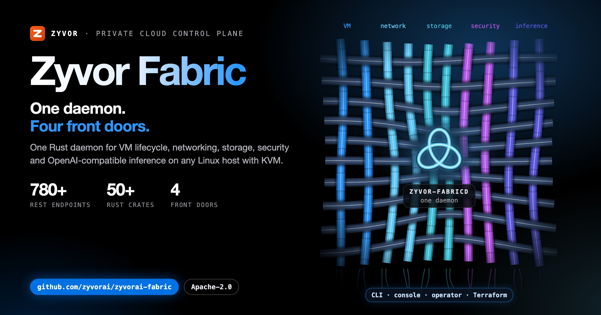
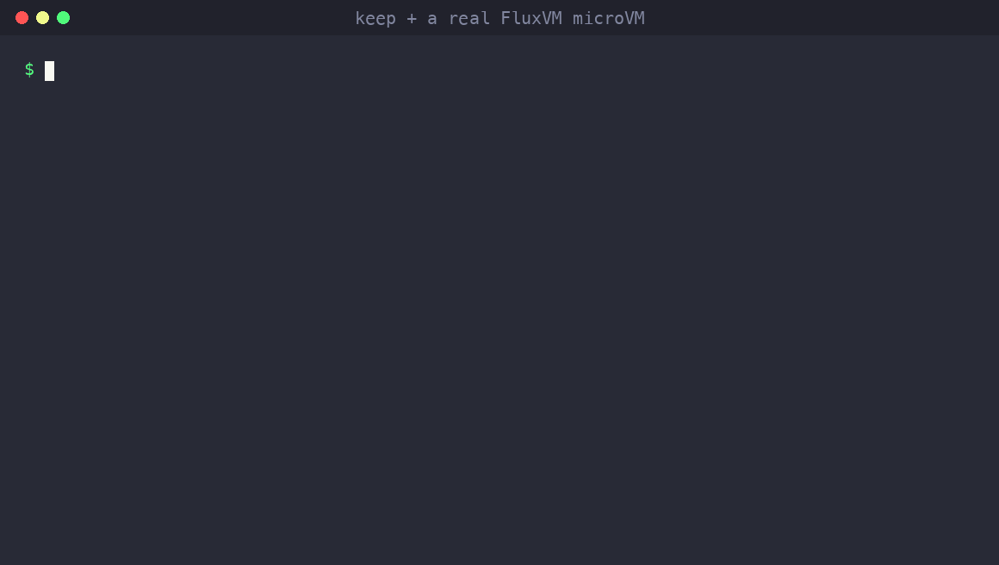
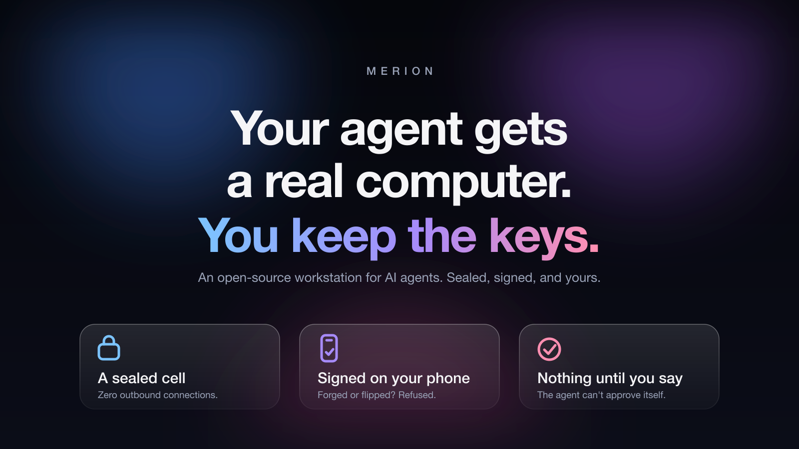
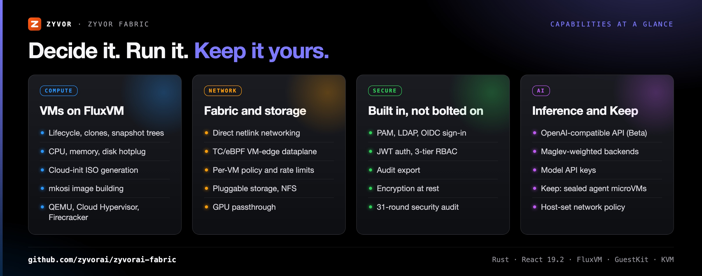
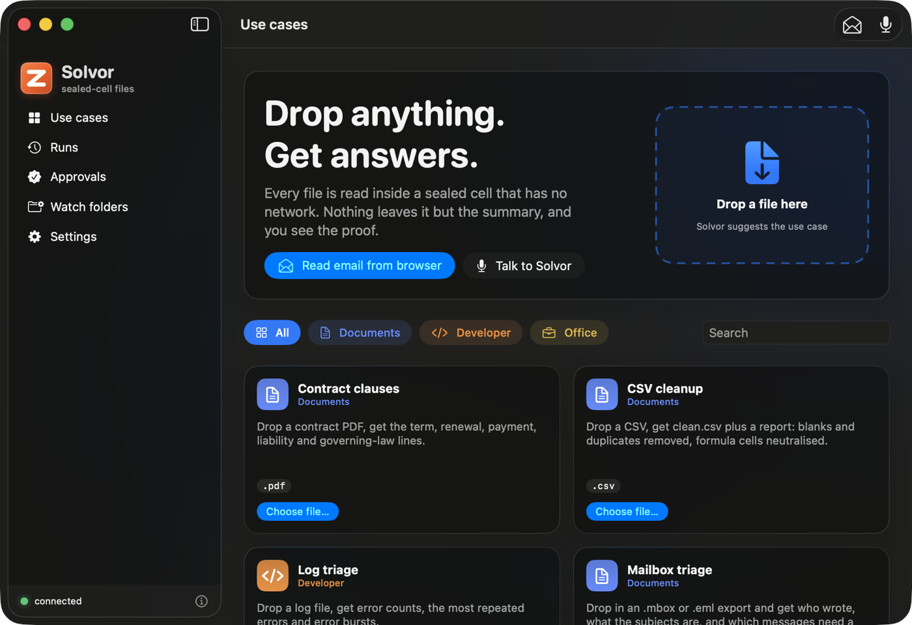
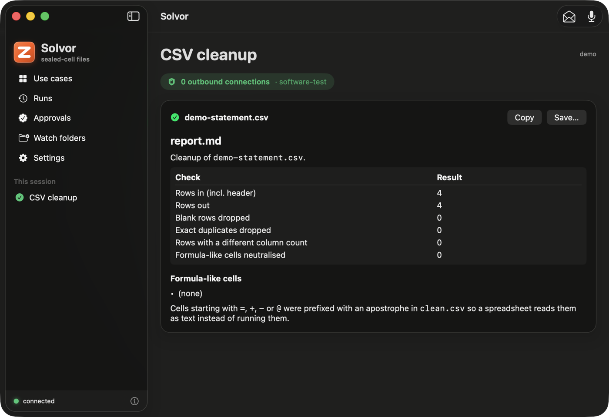
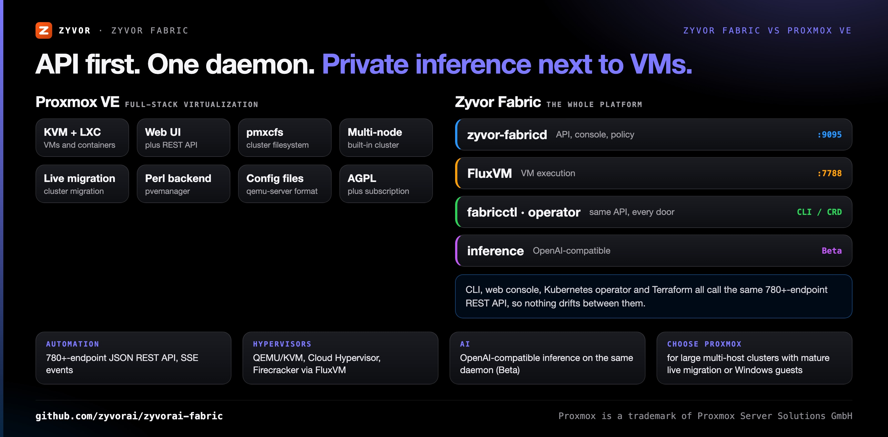
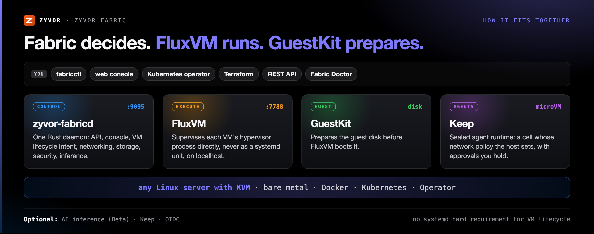

<div align="center">

# Zyvor Fabric

[](https://github.com/zyvorai/zyvorai-fabric/actions/workflows/ci.yml)
[](https://github.com/zyvorai/zyvorai-fabric/actions/workflows/merion.yml)
[](https://github.com/zyvorai/zyvorai-fabric/actions/workflows/agent-runtime.yml)
[](https://github.com/zyvorai/zyvorai-fabric/actions/workflows/ai-workloads.yml)
[](LICENSE)
[](backend/)
[](web/)
[](docs/KUBERNETES.md)
[](https://github.com/zyvorai/zyvor-fluxvm)
[](https://github.com/zyvorai/zyvor-guestkit)

[](https://zyvor.dev/schedule?utm_source=github&utm_medium=fabric&utm_campaign=readme_hero)
[](https://zyvor.dev/poc?utm_source=github&utm_medium=fabric&utm_campaign=readme_hero)
[](#quickstart)



<p align="center">
  
</p>
<p align="center"><sub><b>An agent proposes. A person decides.</b> A real run: the Merion runtime and a real FluxVM microVM on KVM, on a shared lab host. The waits are trimmed; the printed times (75 s to speculate, 118 s to apply) are what that loaded host took, not a benchmark. <a href="docs/assets/demos/README.md">How these are made</a></sub></p>

<h3>The private cloud that fits in one daemon.</h3>

**VMs. Networking. Storage. Security. AI.** One ~15 MB Rust daemon, deployed in about 5 minutes on any Linux server with KVM. Driven the same way from the CLI, the web console, Kubernetes and Terraform.

[**Get started**](#quickstart) · [**Meet Merion**](docs/merion/README.md) · [**Documentation**](docs/index.md) · [**Talk to Zyvor**](https://zyvor.dev)

</div>

<p align="center"></p>

<br>

<div align="center">

## 780+ endpoints. 4 front doors. 1 API.

**53** Rust crates  ·  **92** console pages  ·  **31** security audit rounds, **0** outstanding  ·  Apache-2.0, in full

<sub>Counted from source. <a href="docs/PRODUCT_OVERVIEW.md">Methodology</a></sub>

</div>

---

<div align="center">

# One daemon.
## Four front doors.

</div>

`zyvor-fabricd` gives you VM lifecycle, software-defined networking, pluggable storage, security policy and **OpenAI-compatible AI inference**. The CLI, the web console, the Kubernetes operator and Terraform all talk to the same API, so nothing drifts between them.

Fabric does not implement VM execution itself, and that is deliberate: **Fabric decides what should exist. [FluxVM](https://github.com/zyvorai/zyvor-fluxvm) makes it exist. [GuestKit](https://github.com/zyvorai/zyvor-guestkit) prepares the disk.**

<table>
<tr>
<td valign="top" width="33%">
<h4>Compute and network</h4>
VM lifecycle and software-defined networking, with a TC/eBPF dataplane that enforces per-VM policy and rate limits.<br><br>
<a href="docs/network-fabric-architecture.md">Network Fabric ›</a>
</td>
<td valign="top" width="33%">
<h4>Secure by default</h4>
PAM, LDAP and OIDC sign-in, JWT auth, three-tier RBAC, audit export and encryption at rest. Built in, not bolted on.<br><br>
<a href="SECURITY.md">Security ›</a>
</td>
<td valign="top" width="33%">
<h4>Private inference <sub>Beta</sub></h4>
OpenAI-compatible endpoints on the same daemon: models, Maglev-weighted backends and API keys. Single-cluster Beta, not GA.<br><br>
<a href="docs/ai-workloads-at-a-glance.md">AI Workloads ›</a>
</td>
</tr>
<tr>
<td valign="top" width="33%">
<h4>Agents in a sealed cell</h4>
Merion gives an AI agent a real computer without your network. The host sets the rules; you hold the approvals.<br><br>
<a href="docs/merion/README.md">Merion ›</a>
</td>
<td valign="top" width="33%">
<h4>Kubernetes and Terraform</h4>
Run in a cluster with Helm. The operator turns <code>VirtualMachine</code> resources into API calls. A Terraform provider is included.<br><br>
<a href="docs/KUBERNETES.md">Kubernetes ›</a>
</td>
<td valign="top" width="33%">
<h4>Console and CLI</h4>
A 92-page web console and <code>fabricctl</code>, both first-class against the same REST API.<br><br>
<a href="docs/web-ui.md">Web console ›</a>
</td>
</tr>
</table>



> **Naming:** the product is **Zyvor Fabric**; the daemon, unit and paths stay `zyvor-fabricd`. Canonical repo: [zyvorai/fabric](https://github.com/zyvorai/zyvorai-fabric). See [docs/NAMING.md](docs/NAMING.md).

<a id="ai-workloads-beta"></a>

---

<div align="center">

# Merion.
## Your agent gets a real computer.<br>You keep the keys.

</div>

An open workstation for an AI agent you can't fully trust: a sealed microVM, network rules the host enforces, and approvals only you can give. Run it, read it, take it with you.

<table>
<tr>
<td valign="top" width="50%">
<h4>Approve from anywhere</h4>
Your <b>phone</b> (iPhone or Android) signs each decision with a key that never leaves the device. <b>Slack and Teams</b> get the same request, with the host-rendered preview and its digest. Buttons appear only when no phone signature is required.<br><br>
<a href="docs/merion/design/chatops-approvals.md">Chat approvals ›</a> · <a href="integrations/android-merion/README.md">Android ›</a>
</td>
<td valign="top" width="50%">
<h4>See everything it did</h4>
Every action lands in a signed audit trail. Send it to any <b>OpenTelemetry</b> collector; an allowlist keeps file contents, previews and credentials out.<br><br>
<a href="docs/merion/design/otlp-export.md">OpenTelemetry export ›</a>
</td>
</tr>
<tr>
<td valign="top" width="50%">
<h4>Propose, then decide</h4>
The agent speculates in an isolated copy of the cell. Its changes wait behind an approval, and nothing is applied until a person says yes. The agent can never approve.<br><br>
<a href="docs/merion/README.md">How it works ›</a>
</td>
<td valign="top" width="50%">
<h4>Sealed by design</h4>
A deny-all network policy set by the host, credentials that never enter the cell, and a counter that shows zero outbound connections. The docs say plainly what the evidence class does not prove.<br><br>
<a href="docs/merion/STATUS.md">Status ›</a>
</td>
</tr>
</table>

<p align="center">
  
</p>
<p align="center"><sub><b>An agent proposes. A person decides.</b> A real run on a shared lab host. The waits are trimmed; the printed times (75 s to speculate, 118 s to apply) are what that loaded host took, not a benchmark. <a href="docs/assets/demos/README.md">How these are made</a></sub></p>

<p align="center">
   
</p>
<p align="center"><sub>Solvor, the native Mac client for Merion: pick a use case, then read the result of a run in a sealed cell.</sub></p>

---

<div align="center">

# Every cluster.
## One view.

</div>

Register your other Fabric daemons and see their hosts, VMs and health together in the console. A host that is down never breaks the list, and maintenance runs on the target host's own API with your own permissions. [Federation guide ›](docs/federation.md)


<p align="center"><sub>The console dashboard: fleet health, capability status and live VM metrics at a glance.</sub></p>

---

<div align="center">

# Get started.
## Five minutes. One server.

</div>

<a id="quick-start"></a>

<a id="quickstart"></a>

Requires a Linux server with KVM.

```bash
git clone https://github.com/zyvorai/fabric.git && cd fabric
make build && sudo make install
sudo zyvor-fabricd                                   # or: sudo systemctl enable --now zyvor-fabricd
fabricctl create web-01 --image fedora-41 --cpus 2 --memory 4096 --tenant acme
# Web UI → https://localhost:9095   (console at /app)
```

Default ports: **9095** (API and UI) and **7788** (FluxVM on localhost). The full path table, verification commands and multi-tenant notes are in [Getting started](docs/getting-started.md); a laptop dev setup is in [QUICKSTART.md](QUICKSTART.md).

<a id="deploy"></a>

### Deploy your way

| | |
|---|---|
| **Bare metal** <a id="bare-metal-systemd--easiest-path"></a> | `./scripts/ship USER@HOST` ships FluxVM and Fabric in one command. [Details](docs/deploy.md#bare-metal-systemd--easiest-path) |
| **Docker / Podman** | `make docker-up`, then `http://localhost:9095`. [Details](docs/DOCKER.md) |
| **Kubernetes** <a id="run-on-kubernetes"></a> | `./scripts/deploy k8s USER@HOST` for a k3s lab, or Helm from `charts/zyvor-fabric`. [Details](docs/deploy.md#run-on-kubernetes) · [Guide](docs/KUBERNETES.md) |
| **Operator only** | CRDs that drive an already-running fabricd, from [`operator/`](operator/) |

---

## Who it is for

| If you are… | Use it for | Start here |
|---|---|---|
| Building with AI agents | A sealed microVM per agent run, network rules the host sets, approvals you hold | [Merion](docs/merion/README.md) |
| Running a private cloud | VMs, networking, storage and security from one daemon | [Quickstart](#quickstart) |
| Running Kubernetes | VMs as `VirtualMachine` resources next to your pods | [Kubernetes](docs/KUBERNETES.md) |
| Managing a Mac fleet | Solvor, the native Mac client for Merion | [Solvor](integrations/macos-merion) |
| Wanting inference near your VMs | OpenAI-compatible endpoints on the same daemon (single-cluster Beta) | [AI Workloads](docs/ai-workloads.md) |

<a id="is-this-for-you"></a>

**Is this for you?** It fits API-first automation, single-host or small-cluster deployments, security-conscious teams, and private inference next to the VMs. Look elsewhere for large multi-host clusters with mature live migration today, a deep libvirt-XML ecosystem, or first-class Windows guests. [The honest version](docs/why-fabric.md#is-this-for-you), the [comparison matrix](docs/guides/decision-support/comparison-matrix.md) and the [FAQ](docs/quick-reference/faq.md).

## Fabric vs Proxmox VE



| | **Zyvor Fabric** | **Proxmox VE** |
|---|---|---|
| Hypervisors | QEMU/KVM, Cloud Hypervisor, Firecracker, via [FluxVM](https://github.com/zyvorai/zyvor-fluxvm) | QEMU/KVM plus LXC containers |
| Management layer | FluxVM (systemd-free) + one REST API | pvemanager with a Perl backend |
| Automation | 780+-endpoint JSON REST API, SSE events, Kubernetes operator, Terraform provider included | REST API, `pvesh`, community Terraform providers |
| Cluster model | Single-host or small cluster (multi-host networking available) | Built-in multi-node cluster with its own cluster filesystem (pmxcfs) |
| Live migration | Disk-copy path GA; native FluxVM transport preview; full HA cutover pre-GA | Built-in cluster migration |
| AI inference | OpenAI-compatible inference on the same daemon (Beta) | Not part of the product |
| License | Apache-2.0, in full | AGPL plus an optional subscription |
| **Choose Proxmox VE when** | | You need large multi-host clusters with mature shared-storage live migration today, or first-class Windows guests |

## How it fits together



- <a id="architecture-fluxvm--guestkit"></a>**Architecture:** how Fabric composes FluxVM and GuestKit: [docs/architecture-fluxvm-guestkit.md](docs/architecture-fluxvm-guestkit.md)
- <a id="zyvor-platform-stack"></a>**Zyvor platform stack:** where Fabric sits among the Zyvor products: [docs/platform-stack.md](docs/platform-stack.md)

## Maturity

| Area | Status (from the repo's own docs) |
|---|---|
| VM lifecycle, networking, storage, security, CLI, console, operator, Terraform | Shipped; see [FEATURES.md](FEATURES.md) |
| Live migration | Disk-copy path GA; native FluxVM transport **preview**; full HA cutover **pre-GA** ([comparison matrix](docs/guides/decision-support/comparison-matrix.md)) |
| AI Workloads | Single-cluster **Beta**; multi-site HA store stays **Preview**; **not GA** ([at a glance](docs/ai-workloads-at-a-glance.md)) |
| Merion (was Keep) | Evidence class `software-test`; Merion 0.2 hardware still gated; the Kubernetes chart is rendered and schema-checked but never installed in a cluster ([status](docs/merion/STATUS.md)) |
| Slack/Teams approvals, OpenTelemetry export, federation view, Android app | Merged. Tested against local fakes; not yet against a live Slack workspace, collector, second daemon or Android device |

---

## What's new

| | |
|---|---|
| **Approve from Slack or Teams** | Requests arrive with the host-rendered preview and its digest. Buttons only when no phone signature is required. [Design](docs/merion/design/chatops-approvals.md) |
| **OpenTelemetry export** | Audit entries as OTLP logs, decided approvals as spans, one trace per session. [Design](docs/merion/design/otlp-export.md) |
| **One view across daemons** | Peer Fabric hosts, VMs and health in one console page. [Guide](docs/federation.md) |
| **Android approvals** | `merion-approval-v1` signed with a Keystore key behind biometrics. [README](integrations/android-merion/README.md) |
| **Phone-only approvals** | With signatures required, an unsigned, flipped or forged decision is refused (403) and the approval keeps waiting; a valid one works once. |
| **Speculative execution** | `POST /v1/sessions/{id}/speculate` holds file changes behind a `changeset` approval; a person's approve applies them on FluxVM. Auto-approve is off by default and a required phone signature always wins. [Design](docs/merion/design/auto-approve-changesets.md) |
| **Rename** | **Keep is now Merion**, end to end. [Verification](docs/merion/VERIFICATION.md#after-the-keep--merion-rename-2026-10-16) |

Every release, with the details: **[CHANGELOG.md](CHANGELOG.md)**.

## Documentation

| Topic | Doc |
|---|---|
| Every document, by area | [docs/index.md](docs/index.md) · [docs/documentation-map.md](docs/documentation-map.md) |
| Getting started and deploy | [docs/getting-started.md](docs/getting-started.md) · [docs/deploy.md](docs/deploy.md) · [QUICKSTART.md](QUICKSTART.md) |
| Positioning, overview and every feature | [docs/POSITIONING.md](docs/POSITIONING.md) · [docs/PRODUCT_OVERVIEW.md](docs/PRODUCT_OVERVIEW.md) · [FEATURES.md](FEATURES.md) |
| Architecture | [docs/architecture.md](docs/architecture.md) · [docs/architecture-fluxvm-guestkit.md](docs/architecture-fluxvm-guestkit.md) |
| REST API, OIDC/SSO and networking | [docs/api.md](docs/api.md) · [docs/oidc.md](docs/oidc.md) · [docs/networking.md](docs/networking.md) |
| AI Workloads (Beta) | [docs/ai-workloads.md](docs/ai-workloads.md) · [Tutorial 15](docs/tutorials/15-ai-workloads.md) |
| Merion | [docs/merion/README.md](docs/merion/README.md) · [docs/merion/at-a-glance.md](docs/merion/at-a-glance.md) |
| Tutorials and user manuals | [docs/tutorials/README.md](docs/tutorials/README.md) · [docs/user/README.md](docs/user/README.md) |

## Contributing

Contributions are welcome. See **[CONTRIBUTING.md](CONTRIBUTING.md)** for the development setup, code style and PR process.

```bash
make build          # backend + web
make test           # Rust + web tests
make lint && make fmt
```

`docs/` and this README are authoritative; historical build summaries in the repo root are snapshots.

## Part of the Zyvor stack

| Product | Role next to Zyvor Fabric |
|---|---|
| **Zyvor Fabric** | Private cloud control plane: VMs, networking, storage, security, inference |
| **[FluxVM](https://github.com/zyvorai/zyvor-fluxvm)** | The VM engine Fabric is built on: makes what Fabric decides exist |
| **[GuestKit](https://github.com/zyvorai/zyvor-guestkit)** | Offline VM disk inspection, repair and customization; prepares the disk |
| **[hyper2kvm](https://github.com/zyvorai/hyper2kvm)** | Multi-cloud VM migration, listed next to Fabric in the [platform stack](docs/platform-stack.md) |

→ [zyvor.dev](https://zyvor.dev)

## Support

Free under Apache-2.0. If it helps you, you can donate any amount you like: <https://rzp.io/rzp/utwdYh3>. A donation is voluntary and supports development and maintenance. It is not a purchase: it buys no support, SLA, features, priority or license, and it is not tax-deductible (Zyvor AI Labs Private Limited is a company, not a charity). Zyvor Enterprise (supported releases, SLAs, a named contact and enterprise features) is separate: [sales@zyvor.dev](mailto:sales@zyvor.dev).

## License and support

Zyvor Fabric is **free and open source** under the [Apache License, Version 2.0](LICENSE), in full — there is no dual-licensing or separately-licensed core component. You may use, modify, and run it for personal, lab, and commercial production use at no charge, subject to Apache-2.0 (preserve notices / NOTICE where required). See [NOTICE](NOTICE).

**Zyvor Enterprise** adds what production teams ask for: supported releases, deployment and upgrade guidance, priority incident triage, a named technical contact and 24x7 critical intake. Plans and terms: [docs/SUBSCRIPTION-MODEL.md](docs/SUBSCRIPTION-MODEL.md) · [Pricing](https://zyvor.dev/pricing?utm_source=github&utm_medium=fabric&utm_campaign=readme_license) · [sales@zyvor.dev](mailto:sales@zyvor.dev).

Report vulnerabilities per [SECURITY.md](SECURITY.md).

---

<div align="center">

### Run your private cloud from one daemon

[](https://zyvor.dev/schedule?utm_source=github&utm_medium=fabric&utm_campaign=readme_footer)
[](https://zyvor.dev/poc?utm_source=github&utm_medium=fabric&utm_campaign=readme_footer)
[](https://zyvor.dev/pricing?utm_source=github&utm_medium=fabric&utm_campaign=readme_footer)
[](mailto:sales@zyvor.dev?subject=Zyvor%20Fabric)
[](https://github.com/zyvorai/zyvorai-fabric)

</div>
