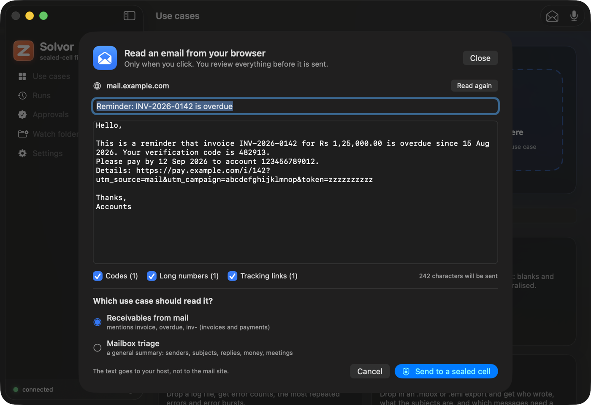
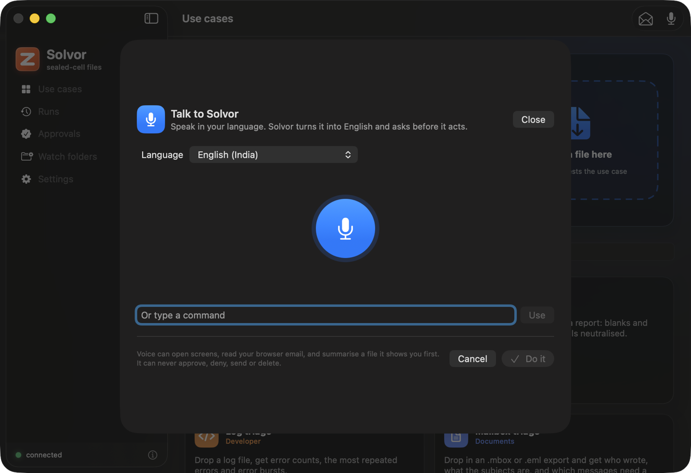

# Solvor

Solvor is a native macOS app (SwiftUI, macOS 26 and later, built on Liquid Glass with the system accent colour) for using Merion from a Mac. Source: [`integrations/macos-merion`](https://github.com/zyvorai/fabric/tree/main/integrations/macos-merion).

**What it is.** A client. You choose or drop a file; the app uploads it to a Merion host you run; the host reads it in a sealed cell that has
no network; the summary comes back and is kept in a history. Every use case the host lists is available: the built-ins, the
[scenario packs](SCENARIOS.md) and your own.

**What it is not.** It does not run commands on your Mac (the "how to get this file" command is shown so you run it yourself), does not drive other
apps (no AppleScript or Accessibility automation), and is not an agent that operates the desktop: a Merion cell is a Linux microVM. It is
also not a signed, notarized release; it builds locally with ad-hoc signing.

## What it does

| Area | What you get | State |
|---|---|---|
| Connect | Host and user token (Keychain, this device only); `GET /v1/keep/status`, `/v1/demos`, `/v1/usage` | Used against a real host |
| Use cases | Searchable cards from the live list, grouped (Documents, Phone, Mac, Windows, Developer, Browser, Office); accepted file types; a copyable "how to get this file" command | Used against a real host |
| Run | Drop files on a card or the window, or choose them; a suggested use case from the file type; several files run as one batch (one cell each, HTTP 207 handled) | Client tested against real cells; drop UI not exercised |
| Result | Markdown summary with tables; "0 outbound connections", the evidence class and the operator-can-read line; Copy and Save | Rendering unit-tested; result view not exercised |
| Runs | History from `GET /v1/artifacts`, open a run, compare two (`/diff`) | Client tested against a real host; UI not exercised |
| Approvals | Pending approvals; approve or deny with a signature made in the Secure Enclave over the exact `keep-approval-v1` text; a Developer-mode enrolment with an operator token that is never stored | Signing checked against the runtime's test vectors; not run against a waiting approval on a host |
| Goals, Memory, Done | **Goals**: your goals with progress, a plan an agent proposed drawn as a timeline (done, current and pending steps; a step that asks first shows why, when the planner gave a reason), accept / accept and run / discard (a plan from a planner that had read untrusted content asks you to confirm), "Ask the agent for a plan", pause and cancel, and the suggestions agents made (off by default; "Make it a goal" or dismiss). **Memory**: an off-by-default switch, add a note, accept or refuse what an agent suggested, delete, forget everything. **Done**: what happened after you approved things, read-only, never the message. All need a *user* token, not the operator one | Client (`MerionKit`) unit-tested and the app builds and its tests pass; **the panes were never opened or clicked** |
| Agent Home | A chat with an agent (`echo-agent`/`memory-agent` or your own), threads kept per agent, a pending approval shown as a "waiting for your Mac" card that only opens Approvals, never decides one | Client unit-tested (`ChatModel` is structurally unable to reach the approval signer or the token store); pane not exercised |
| Watch folders | A rule (folder, patterns, use case) runs new files once (content-hashed) and can save `name.keep.md` next to the file | **Verified end to end**: a file dropped in a watched folder ran in a real cell and its summary was written beside it |
| Read an email from the browser | **Only on your click**: reads the front tab of Safari, Chrome, Brave, Edge or Arc (Firefox has no scripting interface) through Apple Events: the selected text if there is a selection, else the message area. A preview lets you edit the text and switch redaction off or on (one-time codes, long account and card numbers, tracking parameters), suggests the matching mail use case, then sends it to a sealed cell as an `.eml` | Page-to-`.eml` pipeline and the routed packs **verified in real cells**; the browser reading needs your Automation permission and the browser's "Allow JavaScript from Apple Events", so it is **not verified against a real webmail page** |
| Talk to Solvor | Microphone button: Speech transcribes in the language you pick, Apple's on-device Translation turns it into English, a fixed set of commands is recognised (read the browser email, summarise a file or your latest download, show runs, approvals, watch folders). It shows "I heard, I will" and waits for a click | Command parser unit-tested; microphone, Speech and Translation need your permissions and were **not run here** |
| Menu bar | An ask box and a drop target routed into the same Agent Home conversation, up to two waiting approvals as compact cards (opens the full window to decide — a popover has no room for Touch ID), recent runs, run the clipboard as a text use case | Built; not exercised |
| Ask anywhere (⌥Space) | A global hotkey opens a small chat panel over any app, wired to Agent Home; no Accessibility permission needed (`NSEvent` monitors, not a system-wide event tap) | Key-matching logic unit-tested; **not verified against a real keypress or the panel's on-screen appearance** |
| Services | "Send to Merion" in Finder's Services menu (an `NSServices` entry, no extension target) | In Info.plist; not exercised |
| Shortcuts and Siri | App Shortcuts ("Read my email with Solvor", "Summarise my latest download with Solvor", "Show my approvals in Solvor") so Siri and Shortcuts can start the same actions. Siri matches phrases the app registered; it does not translate | Built; **not verified**: Siri and the Shortcuts registration were not run here |
| `keep://run?usecase=…&path=…` | Starts a run from a link | In Info.plist; LaunchServices did not bind the scheme for a build run from a temporary folder, so **unverified** |

## Safety

- Email is **untrusted data**. Reading happens only when you click; the preview always appears before anything is sent; the text goes to your Merion host,
  never to the mail site; Solvor never sends, replies, deletes or clicks anything in your mail and never touches mail credentials. Merion's packs are
  extractive (no model), so an email cannot give the summary an instruction.
- **Voice can never approve or deny.** Approvals need Touch ID. Voice, Siri and Shortcuts cannot send, delete or approve, and a file is only offered
  after it is shown to you and passes the same secret scan and size check as a click.

- Before an upload the app scans the file's name and its first 512 KB for private keys, cloud and token strings and `.env`-style files, and
  asks before sending; it never echoes a secret. Files over a size you choose also ask.
- The token is sent only in the `Authorization` header (the runtime refuses a user token in a URL). The operator token is used only in
  Developer-mode enrolment, once, and is not stored.
- Uploads go to the host you configured. The evidence class is `software-test`: whoever operates the host could still read a cell's memory.
  The app says so in Settings and on every result.

## Screens

| Read an email | Talk to Solvor | A result |
|---|---|---|
|  |  |  |

Screenshots are of the window only, from a debug build against a lab host, with a made-up email.

## How it maps to the API

`GET /v1/keep/status`, `GET /v1/demos`, `POST /v1/demos/{id}` (multipart, repeated `file` fields for a batch), `GET /v1/artifacts`,
`GET /v1/artifacts/{id}`, `GET /v1/artifacts/{a}/diff/{b}`, `GET /v1/inbox`, `GET /v1/approvals`, `POST /v1/approvals/{id}`
(`decision`, `device_id`, `signature`), `POST /v1/users/{id}/devices` (operator only), `GET /v1/usage`, `GET /v1/whoami`. The signed
text is [documented here](mobile/README.md) and pinned by `docs/merion/mobile/test-vectors.json`.

Goals, Memory, Done and Agent Home each add their own routes, all needing a *user* token: `GET /v1/goals`, `POST /v1/goals`,
`PATCH /v1/goals/{id}` (`status`, `autorun`), `POST /v1/goals/{id}/plan` (ask the planner), `POST /v1/goals/{id}/plan/accept`
(`confirm_tainted`, `autorun`), `POST /v1/goals/{id}/plan/reject`; `GET /v1/suggestions`, `PUT /v1/suggestions/settings`
(`enabled`), `POST /v1/suggestions/{id}/accept` (`confirm_tainted`), `POST /v1/suggestions/{id}/dismiss`; `GET /v1/memory`,
`PUT /v1/memory/settings` (`enabled`), `POST /v1/memory` (add a note), `DELETE /v1/memory/{id}`,
`POST /v1/memory/{id}/accept|reject` (a proposal), `DELETE /v1/memory` (forget everything); `GET /v1/receipts`;
`GET /v1/threads`, `GET /v1/threads/{id}/messages`, `DELETE /v1/threads/{id}` and `POST /v1/agui` (Server-Sent Events) for
Agent Home's chat, which streams the same `keep.*` CUSTOM events documented in [AGUI.md](AGUI.md), including a pending
approval surfaced as a chat-only notice — never a decision made from the stream.

## Limits and next steps

No Share-sheet extension (it needs a signed extension target), no notarized build or dmg, no push relay (approvals are polled every 20 s
while the app runs), and the hooks marked "not verified" above still need a run on a Mac with the app installed in `/Applications`. See
[RECIPES.md](RECIPES.md) for calling Merion from Shortcuts, scripts and other agents without this app.
